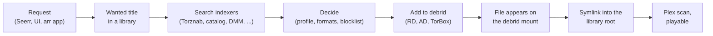

# Theatarr

Theatarr is a debrid-first media manager. One Go service takes the place of several Sonarr and Radarr instances,
Prowlarr, Recyclarr and a debrid bridge. It keeps one title list with several libraries per title (4K and 1080p,
remux and WEB, anime), adds releases to Real-Debrid, AllDebrid and TorBox directly, and links finished downloads from
the debrid mount into your library folders. It serves Radarr- and Sonarr-compatible APIs, so Seerr, Overseerr,
Homepage and the arr phone apps keep working. It is for people who already run an arr stack on debrid, or want to,
and would rather run one service.

## Screenshots


*Home: recently added, upcoming, missing and upgrades found.*


*A movie's page, with its copy in each library.*


*A decision in the journal: the chosen release, the runners-up and why the rest were rejected.*


*Connected apps: the Sonarr- and Radarr-compatible views that Seerr and the arr apps use.*

## Status: alpha

Theatarr is an alpha. Expect changes between versions, rough edges in the UI, and settings or APIs that move. Back up
before every upgrade ([docs/restore.md](docs/restore.md)) and report what breaks in the issue tracker.

It is built so that nothing happens until you say so:

- A library is **Watch only** or **Live**. A new library starts Watch only: Theatarr searches, downloads and links
  nothing for it.
- **Pause** is on for a fresh install. It stops searches, new downloads and library changes for every library;
  downloads already at a provider finish there and are imported when Pause is turned off. Making a library Live,
  turning Pause off, sending a stored key to a new address and deletes ask for a confirmation; other settings save at
  once. Notifications are an ordinary setting.
- On a fresh install, Setup can do all of that in one step, **Create library and start
  downloading**, after one confirmation that lists what it turns on.
- `THEATARR_FORCE_OFF=pause,notify` forces Pause on and notifications off at startup, whatever the saved settings say
  (`router` and `library` still work and also force Pause).

## Features

- **Libraries per title.** Each library has a kind, a quality profile, a root, indexers and debrid providers. A title
  can belong to several libraries.
- **Watch only or Live.** A library starts Watch only (Theatarr searches, downloads and links nothing for it) until
  you set it Live; one Pause stops every library at once.
- **Indexers.** Prowlarr and other Torznab feeds, the Cardigann definition catalog run natively, and built-in
  sources: DMM, Torrentio, Zilean and SeaDex. Each library lists the indexers it searches.
- **Debrid providers.** Real-Debrid, AllDebrid and TorBox, in a fallback order per library, with cache checks,
  pacing and stall handling. A library can also add through an external qBittorrent-API client such as decypharr.
- **Links from the debrid mount.** Imports create symlinks under arr-style naming from a zurg or rclone mount into
  your library roots, repair links that dangle, and keep replaced links in a trash folder.
- **TRaSH-Guides profiles.** Every TRaSH quality profile is built in and can be picked for a library; picking one
  builds a profile with its custom formats that you can edit. Quality sync keeps scores current from a checkout or
  a tracked source. Recyclarr configs can be a sync source.
- **Arr-compatible views.** Radarr- and Sonarr-shaped APIs for Seerr, Overseerr, Homepage, LunaSea, Ruddarr,
  autobrr and other clients, per library or several libraries behind one server.
- **Plex.** Library scans after imports, Plex sign-in, and a now-playing page that shows where each played file
  comes from.
- **Anime.** An anime metadata engine builds each franchise from AniList, AniDB, Kitsu and the community mapping lists
  (ScudLee, Fribb, manami), on its own for every anime series in the library and again weekly, and maps every entry onto
  TVDB and TMDb. Specials, OVAs, recaps, movies and split cours land on the right episodes. Releases numbered by
  absolute episode or named after a franchise entry or an alternate cut map through it. An episode it can't map with
  confidence imports through Sonarr's numbering, and the mapping waits in a review queue. A SeaDex pack covers only the
  cour it belongs to. Plex gets per-franchise playlists in watch or story order. Details:
  [docs/design/anime.md (internals)](docs/design/anime.md).
- **Decision journal.** Every grab, upgrade and search decision with its reasoning, runners-up and suspect flags.
- **Import from an arr.** A one-time import reads a Sonarr or Radarr instance with GET requests only and brings its
  titles, monitoring and debrid-mount files into a library. Radarr and Sonarr lists keep adding new titles.
- **MCP.** An MCP endpoint and a stdio bridge, so an AI agent can set up and check an install with an API key.

## How it works



A request, an RSS feed or a scheduled search makes a title wanted in one or more libraries. Theatarr searches the
library's indexers through one outbound gateway (budgets, back-offs and the optional VPN check), scores the releases
with the library's profile the way the arrs do, and adds the best cached one to the first provider that takes it.
When the files show up on the debrid mount, the library checks them and links them into its root under arr naming,
then asks Plex to scan. See
[docs/design/overview.md (internals)](docs/design/overview.md) for the architecture.

## Not supported yet

Theatarr does not do these yet. If you rely on one of them, keep the tool you use for it today.

- **Native usenet.** There is no NZB downloader. A usenet-to-debrid helper can still drive a library through its
  arr-compatible view.
- **Real torrent clients.** Grabs go to debrid providers or to a qBittorrent-API debrid bridge such as decypharr.
  A seedbox qBittorrent, and hardlink or copy imports of real files, are not supported.
- **Jellyfin and Emby.** They work from the library folders alone; Theatarr does not scan them or sign in with them.
- **Delay profiles and release profiles.** Migration reads them only to warn that they are not carried over.
- **OIDC, LDAP and two-factor sign-in.** Sign-in is a local password or Plex.

[docs/not-supported.md](docs/not-supported.md) has the details and the workarounds.

## Requirements

Required:

- A **debrid account**: Real-Debrid, AllDebrid or TorBox.
- A **debrid mount** such as zurg (Real-Debrid) or rclone with a debrid WebDAV remote, readable by Theatarr and by the
  media server at the paths the symlinks use.
- A **media server that follows symlinks**, such as Plex. Plex is the only one Theatarr talks to (scans, sign-in, now
  playing); others work from the folders alone.
- A **TMDb API key**. Adding titles, search, artwork and release dates need it.
- **Docker** to run the released image (linux/amd64 and linux/arm64), or to build it from source; Go 1.27
  and Node 20 to build without Docker. The arm64 image is untested on real hardware
  ([docs/not-supported.md](docs/not-supported.md#other-gaps)).

Optional:

- A **TVDB key**, for Sonarr-style series numbering and for anime metadata: the anime mappings are built onto TVDB.
- **Indexers**: Prowlarr or Jackett, private trackers, or the built-in sources alone.
- A **TRaSH-Guides checkout**, to follow TRaSH between releases and for quality sync. The TRaSH profiles are built in
  without it.
- **Seerr or Overseerr** for requests, and any arr client you already use.
- A **VPN** for indexer traffic, with the optional egress check.

## Quick start

Pull the released image with [`examples/compose.image.yaml`](examples/compose.image.yaml). Each release publishes
an image for linux/amd64 and linux/arm64 to `ghcr.io/theatarr/theatarr`; the
[Releases page](https://github.com/theatarr/theatarr/releases) lists the versions. The image tag is the version
without the leading `v` (release `v0.2.0` is the image `0.2.0`).

```sh
mkdir theatarr && cd theatarr
curl -fsSL -o compose.yaml https://raw.githubusercontent.com/theatarr/theatarr/main/examples/compose.image.yaml
echo THEATARR_VERSION=0.2.0 > .env             # a version from the Releases page; then edit the host paths in compose.yaml
mkdir -p data && sudo chown 65532:65532 data   # the image runs as uid 65532; so must the library roots and trash
docker compose up -d
```

To build the image from source instead, clone the repository, copy
[`examples/compose.yaml`](examples/compose.yaml) to `compose.yaml` in the checkout and start it with
`docker compose up -d --build`; the other steps are the same.

Open `http://<host>:7700` and create your admin account: the first visit to a new install asks for a username and
password. If you lose the password, run `docker compose exec theatarr theatarr admin reset-password --username <yours>`
(the default is `admin`). On 0.1.5 and older there is no create page: the first admin password is in
`data/initial-admin-password`, and an install from such a version whose password was never used keeps it there.

On a fresh install, creating the account opens **Setup** (`/admin/setup`): add a debrid provider and an indexer,
set the debrid mount and Plex, create a first library (downloading at once, or Watch only to look first), and run the
preflight. The full walkthrough, with what each
compose volume is for, is [docs/quickstart.md](docs/quickstart.md).

## Using Theatarr

**A first library, Watch only.** Setup can create the first library as Watch only: Theatarr searches, downloads and links nothing for it until you set it Live. Add titles from **Search**, or let requests come in.
See [docs/quickstart.md](docs/quickstart.md#6-a-first-library).

**Reading its decisions.** **Activity › Decision journal** lists every decision; an entry opens from its
title link and shows the chosen release, runners-up, rejections and suspect flags. **Admin › Reviews** collects what waits for you: quality updates, anime
mappings, indexer definitions and flagged decisions. See [docs/journal.md](docs/journal.md).

**Going live.** Run `theatarr preflight`, set the library to **Live**, turn **Pause** off, and watch the first
imports. See [docs/quickstart.md](docs/quickstart.md#9-go-live-deliberately).

**Requests.** Add Theatarr to Seerr or Overseerr as a Radarr or Sonarr server: the view path as URL base (for
example `/v/movies/radarr`) and an API key from **Users & access**. See
[docs/quickstart.md](docs/quickstart.md#8-seerr-overseerr-and-the-other-arr-clients).

**The arr apps.** Homepage widgets, LunaSea, Ruddarr and autobrr use the same views and keys. Several libraries can
sit behind one view under **Settings › Connected apps**. The [arr-to-Theatarr map](docs/arr-map.md) shows where each
familiar arr page lives.

**Migrating an arr stack.** **Admin › Import from Sonarr/Radarr** brings one instance's titles, monitoring and files
into a library, once. See [docs/migration.md](docs/migration.md).

## Configuration

Settings live in the database and are edited in the UI under **Admin › Settings**. Each section also has an **Edit
as YAML** editor, and saves apply without a restart. Credentials are stored write-only: the UI and API show whether
one is set, never its value.

YAML is optional. To seed a new database from YAML files, stop the service and run
`theatarr settings import -policy DIR` (it prints a preview), then again with `-confirm`. A running install imports
and exports YAML under **Admin › Advanced › YAML settings › Import & export**. `theatarr policy validate DIR` checks
a directory of YAML files.

The environment sets what the service needs before it can read its database. Most variables have a matching
`theatarr serve` flag (`theatarr serve -h`); `THEATARR_TRASH`, `THEATARR_FORCE_OFF`,
`THEATARR_TVDB_PIN` and `TZ` have no `serve` flag and are read from the environment:

| Variable | Default (image) | What |
|---|---|---|
| `THEATARR_DB` | `/data/theatarr.db` | The SQLite database. Keep it on local storage, not a network share |
| `THEATARR_LISTEN` | `:7700` | Listen address |
| `THEATARR_POLICY` | `/config/policy` | Directory for data files the settings point at, archived with each backup. Optional; startup never imports it |
| `THEATARR_TRASH` | unset | A TRaSH-Guides checkout, for trash_id custom formats and quality sync; the profile presets use it instead of the bundled TRaSH defaults |
| `THEATARR_BACKUP_DIR` | `/data/backups` | Nightly backup sets; `off` turns them off |
| `THEATARR_BACKUP_KEEP` | `14` | Nightly sets to keep |
| `THEATARR_LOG_LEVEL` | `info` | `debug`, `info`, `warn` or `error` |
| `THEATARR_LOG_DIR` | `logs/` next to the database | Rotated JSON logs (`THEATARR_LOG_MAX_FILES`, `THEATARR_LOG_MAX_SIZE`) |
| `THEATARR_COOKIE_SECURE` | `auto` | Secure flag on cookies: `auto` (TLS or `X-Forwarded-Proto: https`), `always`, `never` |
| `THEATARR_METRICS` | `open` | Who may read `/metrics`: `open`, `lan` (private addresses) or `key` |
| `THEATARR_FORCE_OFF` | unset | Comma list of `pause` (also `router`, `library`) and `notify`: forces Pause on and notifications off at startup, whatever the settings say |
| `THEATARR_WORKERS`, `THEATARR_WORKERS_RESERVED` | `2`, `1` | Job worker slots, and extra slots only searches and imports may use |
| `THEATARR_RETENTION_DAYS`, `THEATARR_RETENTION_RUN_DAYS` | `180`, `30` | Days of history and of sync runs kept; `0` keeps them |
| `THEATARR_MOUNT_HELPER` | `true` | Run calls on the debrid mount in helper processes that are killed when a call hangs |
| `THEATARR_TVDB_PIN` | unset | The subscriber PIN for a TVDB key that needs one (a user-supported key); other TVDB keys need none |
| `TZ` | UTC | Time zone; the nightly backup runs at 03:00 local time (`-backup-hour`) |

The MCP bridge reads an admin API key from the variable you name (`theatarr mcp --key-env`) or a file
(`--key-file`). A source can also read its credential from an environment
variable you name in its settings (`api_key_env`); a credential stored in Settings wins.

## Backups and upgrades

`theatarr serve` writes a backup set every night: a consistent copy of the database, the policy directory and a
manifest with hashes. **Admin › System › Backup** lists the sets, writes one on demand and restores one. The
database holds your credentials in plaintext, so keep backups as private as the data directory. Copy `data/backups`
off the host with whatever backs up the host.

To upgrade, write a backup set while the old image still runs, then set `THEATARR_VERSION` in `.env` to the new
release; the old version's tag is the image to go back to:

```sh
docker compose exec theatarr theatarr backup now    # note the set name it prints
echo THEATARR_VERSION=X.Y.Z > .env                  # the new release
docker compose up -d
```

Built from source: keep the old image under another tag (`docker tag theatarr:local theatarr:previous`), then
`git pull` and `docker compose up -d --build`.

Theatarr migrates the database at startup and refuses to start an older image on a newer database, so going back
means restoring that pre-upgrade set with the old image. Set `THEATARR_VERSION` back to the old release (built from
source: `image: theatarr:previous` in `compose.yaml`), then:

```sh
docker compose stop theatarr
docker compose run --rm theatarr backup restore -from /data/backups/SET -db /data/theatarr.db \
  -policy-out /data/policy-restored-STAMP -force    # SET: the set name; STAMP: any new suffix
docker compose up -d
```

[docs/restore.md](docs/restore.md#upgrades-and-image-rollback) has the full steps, including installing the restored
policy directory if you bind one and reconciling the library links afterwards.

## Documentation

[docs/README.md](docs/README.md) is the map: the user guides first, then the design and reference docs in
[docs/design/ (internals)](docs/design/README.md).

## Development and contributing

[docs/dev.md](docs/dev.md) covers the toolchain, the make targets, the code layout and the test rules.
[CONTRIBUTING.md](CONTRIBUTING.md) says how to send changes, and [SECURITY.md](SECURITY.md) how to report a
vulnerability.

## Disclaimer

Theatarr does not host, index or provide any content. It manages requests and files for services you configure
yourself. You are responsible for the services you connect, for following their terms, and for following the law
where you live.

Theatarr is not affiliated with or endorsed by Sonarr, Radarr, Prowlarr, Plex, Seerr, Overseerr, TRaSH-Guides or
any debrid service.

## Licence and acknowledgements

Theatarr is licensed under the GNU Affero General Public License v3.0 ([LICENSE](LICENSE)). Parts of it are ports of
Radarr and Sonarr (GPL-3.0) and of other projects; [NOTICE](NOTICE) lists each one with its licence. The built-in
quality profiles and custom formats are [TRaSH-Guides](https://trash-guides.info/)' work (MIT), bundled unchanged.
