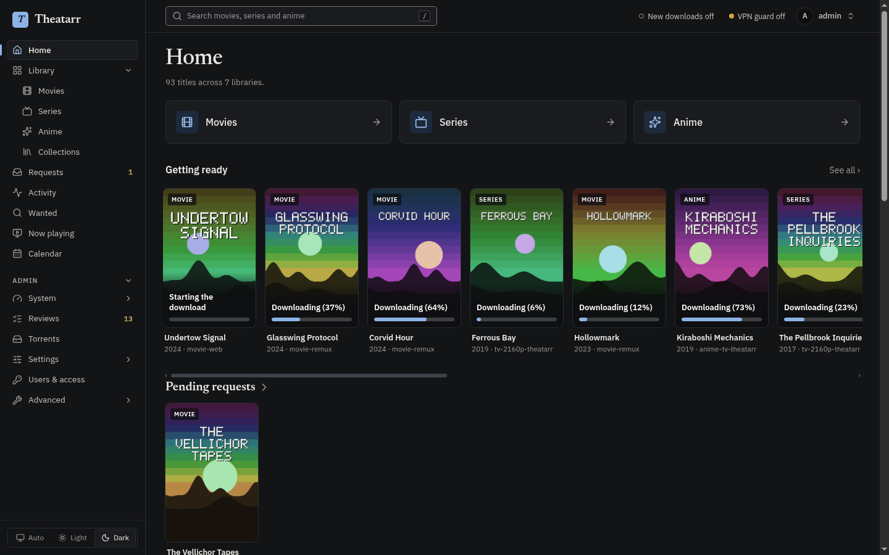
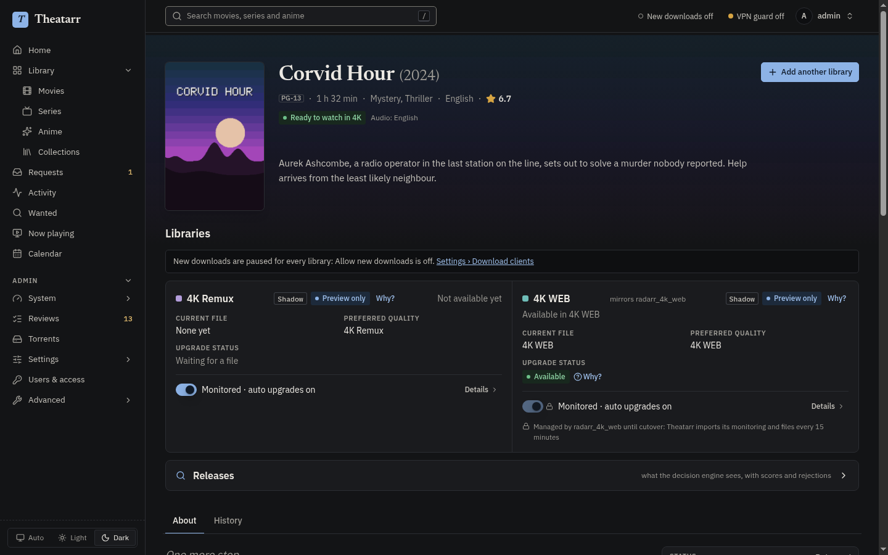
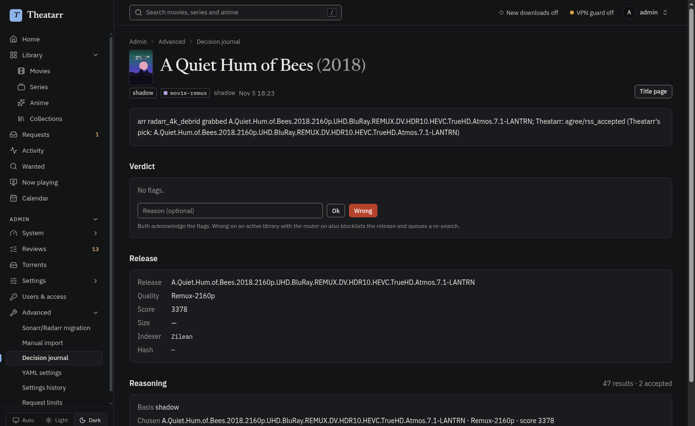
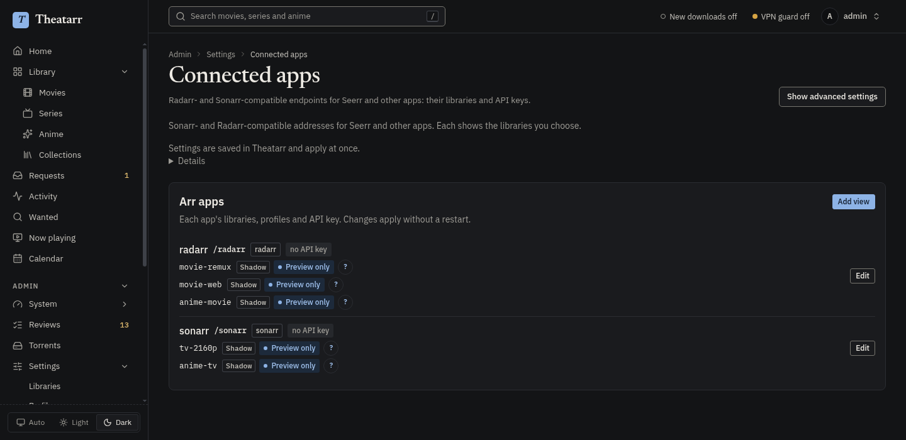
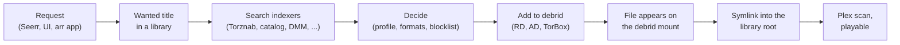

# Theatarr

Theatarr is a debrid-first media manager. One Go service takes the place of several Sonarr and Radarr instances,
Prowlarr, Recyclarr and a debrid bridge. It keeps one title list with several libraries per title (4K and 1080p,
remux and WEB, anime), adds releases to Real-Debrid, AllDebrid and TorBox directly, and links finished downloads from
the debrid mount into your library folders. It serves Radarr- and Sonarr-compatible APIs, so Seerr, Overseerr,
Homepage and the arr phone apps keep working. It is for people who already run an arr stack on debrid, or want to,
and would rather run one service.

## Screenshots


*Home: recently added, upcoming, missing and waiting upgrades.*


*A movie's page, with its copy in each library.*


*A decision in the journal: the chosen release, the runners-up and why the rest were rejected.*


*Connected apps: the Sonarr- and Radarr-compatible views that Seerr and the arr apps use.*

## Status: alpha

Theatarr is an alpha. Expect changes between versions, rough edges in the UI, and settings or APIs that move. Back up
before every upgrade ([docs/restore.md](docs/restore.md)) and report what breaks in the issue tracker.

It is built so that nothing happens until you say so:

- A new library starts in **shadow mode**: it searches and decides what it would grab, and records that, but adds
  nothing to debrid and writes nothing to the library.
- The global switches `router.enabled` (**Allow new downloads**) and `library.enabled` (**Write library links**) are
  off on a fresh install. An admin turns them on, and each risky change asks for a confirmation.
- `THEATARR_FORCE_OFF=router,library,notify` forces the switches off at startup, whatever the saved settings say.

## Features

- **Libraries per title.** Each library has a kind, a quality profile, a root, indexers and debrid providers. A title
  can belong to several libraries.
- **Shadow mode.** A library records its decisions without acting on them, so you can compare before it goes live.
  Migrated libraries can follow an arr side by side until you hand over.
- **Indexers.** Prowlarr and other Torznab feeds, the Cardigann definition catalog run natively, and built-in
  sources: DMM, Torrentio, Zilean and SeaDex. Each library lists the indexers it searches.
- **Debrid providers.** Real-Debrid, AllDebrid and TorBox, in a fallback order per library, with cache checks,
  pacing and stall handling. A library can also add through an external qBittorrent-API client such as decypharr.
- **Links from the debrid mount.** Imports create symlinks under arr-style naming from a zurg or rclone mount into
  your library roots, repair links that dangle, and keep replaced links in a trash folder.
- **TRaSH-Guides profiles.** Presets build quality profiles and custom formats from a TRaSH-Guides checkout, and
  quality sync keeps their scores current. Recyclarr configs can be a sync source.
- **Arr-compatible views.** Radarr- and Sonarr-shaped APIs for Seerr, Overseerr, Homepage, LunaSea, Ruddarr,
  autobrr and other clients, per library or several libraries behind one server.
- **Plex.** Library scans after imports, Plex sign-in, and a now-playing page that shows where each played file
  comes from.
- **Decision journal.** Every grab, upgrade and shadow decision with its reasoning, runners-up and suspect flags.
- **Migration from an arr stack.** Reads Sonarr, Radarr, Prowlarr, Seerr and Recyclarr with GET requests only and
  plans the move; everything lands disabled or in shadow.
- **MCP.** An MCP endpoint and a stdio bridge, so an AI agent can set up, migrate and check an install with an API
  key.

## How it works



A request, an RSS feed or a scheduled search makes a title wanted in one or more libraries. Theatarr searches the
library's indexers through one outbound gateway (budgets, back-offs and the optional VPN check), scores the releases
with the library's profile the way the arrs do, and adds the best cached one to the first provider that takes it.
When the files show up on the debrid mount, the library checks them and links them into its root under arr naming,
then asks Plex to scan. In shadow mode the same chain stops after the decision. See
[docs/design/overview.md](docs/design/overview.md) for the architecture.

## Requirements

Required:

- A **debrid account**: Real-Debrid, AllDebrid or TorBox.
- A **debrid mount** such as zurg (Real-Debrid) or rclone with a debrid WebDAV remote, readable by Theatarr and by the
  media server at the paths the symlinks use.
- A **media server that follows symlinks**, such as Plex. Plex is the only one Theatarr talks to (scans, sign-in, now
  playing); others work from the folders alone.
- A **TMDb API key**. Adding titles, search, artwork and release dates need it.
- **Docker** to build and run the image, or Go 1.27 and Node 20 to build from source.

Optional:

- A **TVDB key**, for Sonarr-style series numbering and for anime metadata.
- **Indexers**: Prowlarr or Jackett, private trackers, or the built-in sources alone.
- A **TRaSH-Guides checkout** for the profile presets and quality sync.
- **Seerr or Overseerr** for requests, and any arr client you already use.
- A **VPN** for indexer traffic, with the optional egress check.

## Quick start

There is no published image yet; you build it from this repository.

```sh
git clone <this repository> theatarr && cd theatarr
cp examples/compose.yaml compose.yaml      # then edit the host paths
mkdir -p data && sudo chown 65532:65532 data   # the image runs as uid 65532; so must the library roots and trash
git clone --depth 1 https://github.com/TRaSH-Guides/Guides trash-guides   # optional: profile presets
docker compose up -d --build
sudo cat data/initial-admin-password
```

Open `http://<host>:7700` and sign in as `admin` with that password. The file is deleted at the first login; if you
lose the password, run `docker compose exec theatarr theatarr admin reset-password`.

A fresh install lands on Home with a **Finish setting up** card that leads to **Setup** (`/admin/setup`): change the admin password, add a debrid provider and an indexer,
set the debrid mount and Plex, create a first library, and run the preflight. The full walkthrough, with what each
compose volume is for, is [docs/quickstart.md](docs/quickstart.md).

## Using Theatarr

**A first library in shadow.** Setup creates the first library in shadow mode with downloads off. It records what it
would have grabbed from the RSS feeds of its indexers, from the grabs of an arr it follows, and when you run
`theatarr decide`. Add titles from **Search**, or let requests come in.
See [docs/quickstart.md](docs/quickstart.md#6-a-first-library).

**Reading its decisions.** **Admin › Advanced › Decision journal** lists every decision; an entry opens from its
title link and shows the chosen release, runners-up, rejections and suspect flags. **Admin › Reviews** collects what waits for you: quality updates, anime
mappings, indexer definitions and flagged decisions. See [docs/journal.md](docs/journal.md).

**Going live.** When the decisions look right, run `theatarr golive check -version KEY`, set the library to
**Active**, turn on **Allow downloads for this library**, **Write library links** and **Allow new downloads**, and
watch the first imports. See [docs/quickstart.md](docs/quickstart.md#9-go-live-deliberately) and
[docs/golive.md](docs/golive.md).

**Requests.** Add Theatarr to Seerr or Overseerr as a Radarr or Sonarr server: the view path as URL base (for
example `/v/movies/radarr`) and an API key from **Users & access**. See
[docs/quickstart.md](docs/quickstart.md#8-seerr-overseerr-and-the-other-arr-clients).

**The arr apps.** Homepage widgets, LunaSea, Ruddarr and autobrr use the same views and keys. Several libraries can
sit behind one view under **Settings › Connected apps**. The [arr-to-Theatarr map](docs/arr-map.md) shows where each
familiar arr page lives.

**Migrating an arr stack.** **Admin › Advanced › Sonarr/Radarr migration**, or `theatarr migrate inspect | plan |
apply | verify`, reads your existing Sonarr, Radarr, Prowlarr, Seerr and Recyclarr setup and adds it disabled or in
shadow. A follower library then runs beside each arr until you hand over clients and Plex. See
[docs/migration.md](docs/migration.md), [docs/parallel.md](docs/parallel.md) and [docs/golive.md](docs/golive.md).

## Configuration

Settings live in the database and are edited in the UI under **Admin › Settings**. Each section also has an **Edit
as YAML** editor, and saves apply without a restart. Credentials are stored write-only: the UI and API show whether
one is set, never its value.

YAML is optional. To seed a new database from YAML files, stop the service and run
`theatarr settings import -policy DIR` (it prints a preview), then again with `-confirm`. A running install imports
and exports YAML under **Admin › Advanced › YAML settings › Import & export**. `theatarr policy validate DIR` checks
a directory of YAML files.

The environment sets what the service needs before it can read its database. Each variable has a matching
`theatarr serve` flag (`theatarr serve -h`):

| Variable | Default (image) | What |
|---|---|---|
| `THEATARR_DB` | `/data/theatarr.db` | The SQLite database. Keep it on local storage, not a network share |
| `THEATARR_LISTEN` | `:7700` | Listen address |
| `THEATARR_POLICY` | `/config/policy` | Directory for data files the settings point at, archived with each backup. Optional; startup never imports it |
| `THEATARR_TRASH` | unset | A TRaSH-Guides checkout, for the profile presets, custom formats and quality sync |
| `THEATARR_BACKUP_DIR` | `/data/backups` | Nightly backup sets; `off` turns them off |
| `THEATARR_BACKUP_KEEP` | `14` | Nightly sets to keep |
| `THEATARR_LOG_LEVEL` | `info` | `debug`, `info`, `warn` or `error` |
| `THEATARR_LOG_DIR` | `logs/` next to the database | Rotated JSON logs (`THEATARR_LOG_MAX_FILES`, `THEATARR_LOG_MAX_SIZE`) |
| `THEATARR_COOKIE_SECURE` | `auto` | Secure flag on cookies: `auto` (TLS or `X-Forwarded-Proto: https`), `always`, `never` |
| `THEATARR_METRICS` | `open` | Who may read `/metrics`: `open`, `lan` (private addresses) or `key` |
| `THEATARR_FORCE_OFF` | unset | Comma list of `router`, `library`, `notify`: forced off at startup, whatever the settings say |
| `THEATARR_WORKERS`, `THEATARR_WORKERS_RESERVED` | `2`, `1` | Job worker slots, and extra slots only searches and imports may use |
| `THEATARR_RETENTION_DAYS`, `THEATARR_RETENTION_RUN_DAYS` | `180`, `30` | Days of history and of sync runs kept; `0` keeps them |
| `THEATARR_MOUNT_HELPER` | `true` | Run calls on the debrid mount in helper processes that are killed when a call hangs |
| `THEATARR_PUBLIC_URL` | unset | Theatarr's address as clients reach it, used in the client steps of `golive check` and `migrate verify` |
| `TZ` | UTC | Time zone; the nightly backup runs at 03:00 local time (`-backup-hour`) |

The CLI tools that talk to a running service read an admin API key from `THEATARR_API_KEY` (`theatarr migrate`) or
the variable you name (`theatarr mcp --key-env`). A source can also read its credential from an environment
variable you name in its settings (`api_key_env`); a credential stored in Settings wins.

## Backups and upgrades

`theatarr serve` writes a backup set every night: a consistent copy of the database, the policy directory and a
manifest with hashes. **Admin › System › Backup** lists the sets, writes one on demand and restores one. The
database holds your credentials in plaintext, so keep backups as private as the data directory. Copy `data/backups`
off the host with whatever backs up the host.

To upgrade, write a backup set while the old image still runs, keep the old image under another tag, then rebuild
from the new source:

```sh
docker compose exec theatarr theatarr backup now    # note the set name it prints
docker tag theatarr:local theatarr:previous         # keep the old image
git pull
docker compose up -d --build
```

Theatarr migrates the database at startup and refuses to start an older image on a newer database, so going back
means restoring that pre-upgrade set with the old image. Set `image: theatarr:previous` in `compose.yaml`, then:

```sh
docker compose stop theatarr
docker compose run --rm theatarr backup restore -from /data/backups/SET -db /data/theatarr.db \
  -policy-out /data/policy-restored-STAMP -force    # SET: the set name; STAMP: any new suffix
docker compose up -d
```

[docs/restore.md](docs/restore.md#upgrades-and-image-rollback) has the full steps, including installing the restored
policy directory if you bind one and reconciling the library links afterwards.

## Documentation

[docs/README.md](docs/README.md) is the map: the user guides first, then the design and reference docs in
[docs/design/](docs/design/README.md).

## Development and contributing

[docs/dev.md](docs/dev.md) covers the toolchain, the make targets, the code layout and the test rules.
[CONTRIBUTING.md](CONTRIBUTING.md) says how to send changes, and [SECURITY.md](SECURITY.md) how to report a
vulnerability.

## Disclaimer

Theatarr does not host, index or provide any content. It manages requests and files for services you configure
yourself. You are responsible for the services you connect, for following their terms, and for following the law
where you live.

Theatarr is not affiliated with or endorsed by Sonarr, Radarr, Prowlarr, Plex, Seerr, Overseerr, TRaSH-Guides or
any debrid service.

## Licence and acknowledgements

Theatarr is licensed under the GNU Affero General Public License v3.0 ([LICENSE](LICENSE)). Parts of it are ports of
Radarr and Sonarr (GPL-3.0) and of other projects; [NOTICE](NOTICE) lists each one with its licence.
