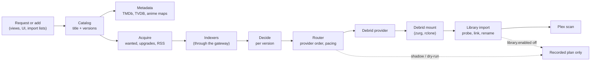

# Overview

Theatarr is one Go service that manages a movie and TV library on debrid storage. It keeps the titles, their
metadata and every version of them a library wants; it searches indexers, decides which releases to take with the
arrs' rules, adds them to a debrid provider (Real-Debrid, AllDebrid or TorBox), and links the files from the debrid
mount (zurg and rclone) into the library folders Plex reads. Radarr- and Sonarr-shaped APIs ("views") let Seerr,
Homepage, phone apps and download tools talk to it as if it were an arr.

It runs as one process with one binary, a SQLite database and a job queue in that database. The browser UI is a
React app over the same native API the clients use. This page names the parts; the other design docs describe
each one ([README.md](README.md)).

## Domain model

| Term | What it is | Where |
|---|---|---|
| **Title** | A movie or series, keyed by its TMDb id (TVDB for series), with its external ids, names, release dates and episodes | `title`, `episode`; [tv-metadata.md](tv-metadata.md) |
| **Library** (`version`) | One way a title should be held: a version policy (`versions.<key>`) with a profile, a library root, naming, allowed indexers and providers, and a mode. A title has one version per library that applies to it; a series has a state per episode. The UI says "library", the code and settings say `version` | `version`, `episode_version_state`; [settings.md](settings.md) |
| **Profile** and **formats** | Ordered qualities, cutoff, sizes and custom format scores, arr-shaped; TRaSH formats by `trash_id` | [profiles.md](profiles.md), [formats.md](formats.md) |
| **Release** | One search result: indexer, title, info hash, size, seeders, flags, privacy label. Links stay in memory | [indexers.md](indexers.md) |
| **Decision** | A release judged for one version: accepted or rejected with the arr's reason names, quality, formats, score and whether it upgrades the current file | [decide.md](decide.md) |
| **Grab** (download) | An accepted release the router adds to a provider for a version: provider attempts, state and the provider's id | `download`; [router.md](router.md) |
| **Provider torrent** (content) | A torrent on a debrid account, keyed by info hash, with the files it holds and which accounts list it. One content can back links in several libraries | `content`, `content_version`; [providers.md](providers.md), [torrents.md](torrents.md) |
| **Link** | A symlink in a library folder pointing at a file on the debrid mount, with the release it came from and its parse, formats and score at import | `link`; [library.md](library.md) |
| **View** | A Radarr- or Sonarr-shaped API over a chosen set of versions, with its own API key | [arrview.md](arrview.md), [devices.md](devices.md) |

A file is linked once inside one Plex library: when one release fits two versions in the same folder tree, both
use the same link.

## The pipeline

1. **Add.** A request through a view (`POST movie`, `POST series`), the UI, or an import list goes through the one
   add path, `internal/catalog`: find or create the title, turn the chosen versions on.
2. **Metadata.** `internal/metadata/tmdb`, `internal/metadata/tvdb`, `internal/metadata/tvrefresh` and
   `internal/metadata/anime` fill titles, episodes, numbering schemes and anime mappings; `internal/metadata/art`
   serves artwork ([tvdb.md](tvdb.md), [anime.md](anime.md), [artwork.md](artwork.md)).
3. **Search.** `internal/acquire` runs the searches of active versions (wanted, cutoff upgrades, search commands
   from the views) and the RSS sync. `internal/indexer` turns each indexer (Torznab, DMM, Torrentio, Zilean, SeaDex,
   native Cardigann definitions) into a searcher, with single-flight and a result cache
   ([indexers.md](indexers.md), [cardigann.md](cardigann.md)).
4. **Decide.** `internal/decide` parses each release with the Radarr or Sonarr parser port, maps it to the title,
   scores formats and runs the arr's specifications for every version ([decide.md](decide.md),
   [series.md](series.md)).
5. **Route.** `internal/router` takes the ranked, accepted releases of one search and adds the best to the
   version's providers in order, as a bare magnet, cached-only by default, with pacing and back-off; or hands it to
   an external qBittorrent-API client (`internal/qbit`, [external-clients.md](external-clients.md)). Provider reads
   and the content registry are `internal/provider`; writes are `internal/provider/adder` ([router.md](router.md),
   [providers.md](providers.md)).
6. **Import.** `internal/library` finds the release on the debrid mount, probes the video headers, applies the
   sample and fake guard, links each file into the version's root with its naming, and asks Plex for a partial
   scan (`internal/plex`) ([library.md](library.md)).
7. **Serve.** `internal/arrview` answers the views from Theatarr's database; `internal/web` is the native API and
   `internal/webui` the React app ([arrview.md](arrview.md), [web.md](web.md), [ui.md](ui.md)).

### A request, end to end

1. Seerr asks the `/sonarr` view for a series with the view's anime profile.
2. The catalog creates the title and turns on the anime version the view maps that profile to; metadata fills the
   episodes and the anime mapping.
3. The acquirer plans one search per season within each indexer's budget, SeaDex included.
4. Each release is decided for the version; the best accepted one is routed to the first provider in the
   version's order that takes it, as a bare magnet.
5. When the provider reports the torrent ready and the files appear on the mount, the import probes them, links
   each episode into the version's root with its naming, and records the content and its links.
6. Plex scans those folders. Seerr sees progress through the view's `queue` and availability through Plex.

In shadow, or with `router.enabled` off, the same request stops after step 4 with a recorded plan.

Around the pipeline:

| Package | Does |
|---|---|
| `internal/gateway` | The single outbound HTTP path: host allowlist, VPN egress guard, budgets, back-off ([gateway.md](gateway.md)) |
| `internal/acquire/rss` | The RSS sync: reads the Live libraries' feeds and routes what they accept ([rss.md](rss.md)) |
| `internal/shadow` | The periodic arr import (`arr.import`) of the `import.arr` instances ([import-arr.md](import-arr.md)) |
| `internal/importarr`, `internal/migration` | Read existing arr instances (GET only) into the database; the guided migration ([import-arr.md](import-arr.md)) |
| `internal/torrents` | The provider torrent manager: usage, backups, restores, deletes a person picks ([torrents.md](torrents.md)) |
| `internal/jobs` | The persistent job queue: leases, retries, schedules ([jobs.md](jobs.md)) |
| `internal/health`, `internal/preflight` | Health checks and readiness ([readiness.md](readiness.md)) |
| `internal/auth` | Users, sessions, API keys and permissions ([users.md](users.md)) |
| `internal/store` | SQLite: one writer connection, a reader pool, goose migrations, backups |

## Safety model

Nothing writes to a provider or the library until it is turned on, step by step:

- **Watch only.** Every version starts as Watch only (`mode: shadow`): Theatarr searches, downloads and links
  nothing for it. Live (`mode: active`) searches, downloads and links.
- **Pause.** One switch, on for a fresh install, stops searches, new downloads and library changes for every library.
  The runtime switches `router.enabled` (provider writes: add a magnet, select files) and `library.enabled`
  (filesystem writes and Plex calls) are both derived from it. The router writes for a version only when Pause is
  off and the version is Live; a link is written only when Pause is off, the version is Live, and the path is under
  one of the version's roots (or the trash directory) ([library.md](library.md)). Downloads already at a provider
  finish there and are imported when Pause is turned off.
- **The gateway.** Every outbound request goes through `internal/gateway` and its host allowlist. With an `egress`
  section, indexer traffic (by default) is refused unless a fresh egress check saw a VPN exit address; without
  one the guard is off and the UI warns about it ([gateway.md](gateway.md)).
- **Deletes.** The router deletes only its own just-made uncached add and its own stalled add. Any other provider
  delete is one a person picks in the torrent manager, after a preview, a confirmation and a backup
  ([torrents.md](torrents.md)).
- **Read-only sources.** The arr importers use GET only, and the debrid mount is only read.

## Running it

`theatarr serve` runs everything in one process: the HTTP server (native API, views, UI, `/healthz`, `/readyz`,
`/metrics`), the job workers, the acquirer, the router's poller, the library import, the RSS sync, the arr import and the
egress check. The default port is 7700. The data directory (`/data` in the container) holds the database, the
first-start admin password file, the Cardigann definitions and the torrent-list backups. One-shot commands
(`theatarr search`, `decide`, `import-arr`, `providers`, `torrents`, `preflight`) work on the same
database.

## Settings

Settings live in the database (`internal/settings`): validated sections and records, credentials, generations and
a redacted audit trail. A save is validated, committed and published as a new runtime generation without a restart;
changes that widen what Theatarr reaches or writes ask for confirmation. The settings pages edit them
([settings.md](settings.md)).

YAML is the import and export format. `theatarr settings import -policy <dir> -db <db>` previews an import into a
database without settings and `-confirm` applies it; a running service imports and exports under Advanced ›
YAML settings › Import & export. Exports carry no secret values. The example policy is in `examples/policy/`.
